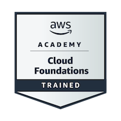
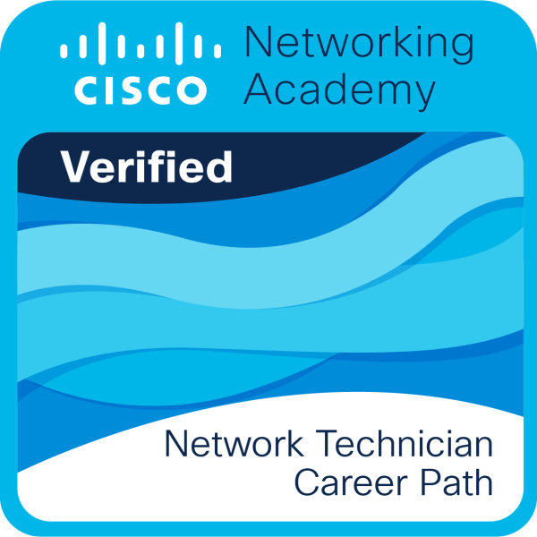

  

  

---

### 🚀 Sobre mim

Estudante de Sistemas de Informação no **CESAR School** focado em **Análise de Dados** e **Engenharia de Dados**. Desenvolvo soluções com foco em manipulação, modelagem, automação e visualização estratégica de dados, integrando conceitos fundamentais de computação em nuvem e redes.

- 🔭 **Atualmente trabalhando em:** Pipelines de dados, ETL e Data Warehouse analítico para telemetria esportiva (*PostgreSQL, Python, Docker e Power BI*)

- 🌱 **Aprimorando conhecimentos em:** Modelagem Dimensional (*Star Schema*), Engenharia de Dados com Python/SQL e Dashboards no Power BI

- 👯 **Buscando colaborar em:** Projetos de Engenharia de Dados, Business Intelligence (BI) e Análise de Dados

- 💬 **Principais temas e tecnologias:** Python, SQL, PostgreSQL, Power BI, Docker, Fundamentos AWS e Redes Cisco

---

### 🛠️ Tecnologias & Ferramentas

**Linguagens & Consultas:**

  
  

**Dados & Análise:**

  
  
  

**Bancos de Dados & Infraestrutura:**

  
  
  
  

---

**Ferramentas, Versionamento & Gestão:**

  
  
  
  
  

### 🔗 Redes & Contato

  
  

---

### 📜 Certificações & Treinamentos

<table>
  <tr>
    <td width="110" align="center">
      
    </td>
    <td>
      <strong>AWS Academy Graduate – Cloud Foundations</strong> 
      <em>Amazon Web Services (AWS)</em> 
      Fundamentos conceituais da nuvem AWS, serviços principais (computação, armazenamento, redes e bancos de dados), segurança, modelo de precificação e arquitetura básica em nuvem.
    </td>
  </tr>
  <tr>
    <td width="110" align="center">
      
    </td>
    <td>
      <strong>Fundamentos da Rede</strong> 
      <em>Cisco Networking Academy & CESAR School</em> (Concluído em Jan/2026) 
      Conceitos de arquitetura de redes, protocolos de comunicação, endereçamento IP, conectividade e infraestrutura básica essencial para integração de serviços e segurança.
    </td>
  </tr>
</table>